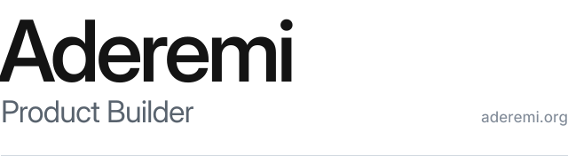
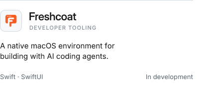
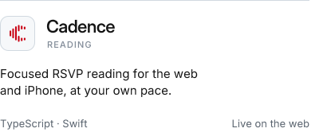
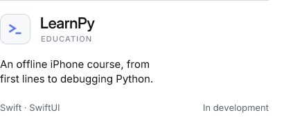
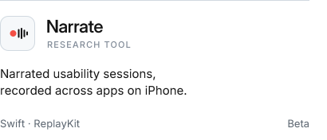

<picture><source media="(prefers-color-scheme: dark)" srcset="assets/header-dark.svg"></picture>

I design and build software end to end: from research and interface design to native Apple apps, audio software and the developer tools that help ship them.

Software engineering · Product design · Design engineering · macOS and iOS · Audio software · Developer tooling · AI-assisted development · Product architecture

### Selected work

<picture><source media="(prefers-color-scheme: dark)" srcset="assets/card-freshcoat-dark.svg"></picture> <a href="https://readwithcadence.com"><picture><source media="(prefers-color-scheme: dark)" srcset="assets/card-cadence-dark.svg"></picture></a> <picture><source media="(prefers-color-scheme: dark)" srcset="assets/card-learnpy-dark.svg"></picture> <a href="https://aderemi.org/narrate"><picture><source media="(prefers-color-scheme: dark)" srcset="assets/card-narrate-dark.svg"></picture></a>

Most of this work is in private development. Write-ups live at <a href="https://aderemi.org">aderemi.org</a>.

 

<picture><source media="(prefers-color-scheme: dark)" srcset="assets/waveform-dark.svg"></picture>

<samp><a href="https://aderemi.org">aderemi.org</a> · <a href="https://someforsome.com">someforsome.com</a> · <a href="https://x.com/a4518513i">x.com/a4518513i</a></samp>
